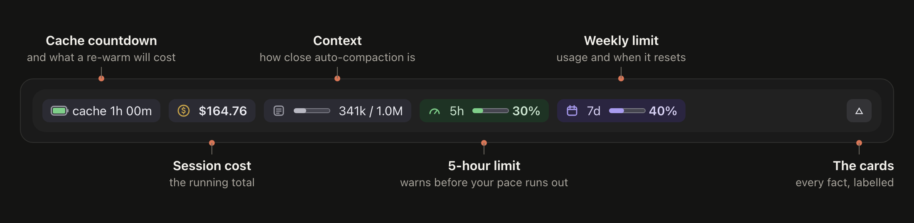
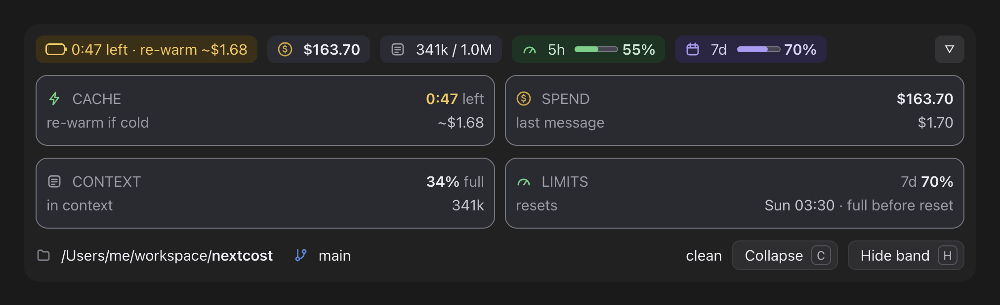
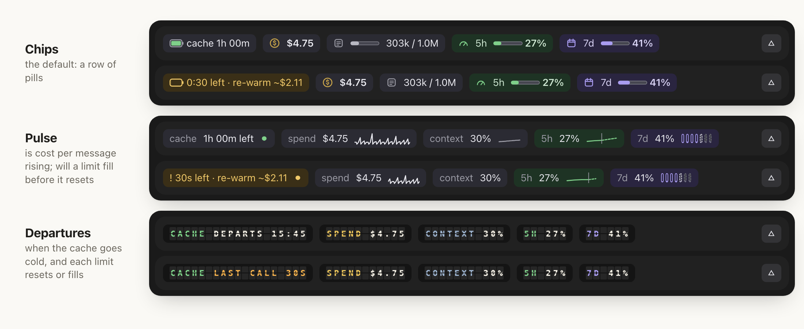

# nextcost

The price of your next Claude Code message, before you send it. This Claude
Code plugin draws a calm band above the prompt that answers: is my cache
still warm, what will the next message cost if it isn't, what is this
session costing, and am I close to a limit? It spends no tokens and makes
no network calls. By default it is one row of chips:



Two more [layouts](#layouts) draw the same readings in other shapes:
`pulse` (the session's trace, for trends) and `departures` (a split-flap
board, for times). Try every state live on the [website](https://hmarzban.github.io/nextcost/),
and see the [changelog](CHANGELOG.md) for what changed in each version. Found
something off? [Open an issue](https://github.com/HMarzban/nextcost/issues/new?template=bug_report.yml).

## Install

```bash
claude plugin install nextcost --marketplace HMarzban/nextcost
```

It loads in your next session, or run `/reload-plugins` in an open one.

The band needs Claude Code with mods (function-hooks plugins). CI tests
every change on 2.1.299 and the latest release (2.1.316 at 0.21.0), so
2.1.299 is the oldest version tested. The one-line form needs Claude Code
2.1.292 or later; on an older one, add the marketplace first
(`claude plugin marketplace add HMarzban/nextcost`), then
`claude plugin install nextcost@hossein-mods`.

Older than 2.1.299 isn't tested. Known differences there: before 2.1.290,
Claude Code doesn't tell a mod how many tool calls Anthropic ran, so for a
session that uses the advisor the band's re-warm quotes run about 58% high
(replayed on real transcripts), which makes 2.1.290 the floor for an accurate
price; idle compaction is also a 2.1.290 feature, so older versions never
compact an idle session; before 2.1.275, `/plugin install` inside a session
isn't there.

The desktop app bundles its own Claude Code, so a surface's version can differ
from the terminal's (2.1.309 against 2.1.316 on one machine here). What counts
is the version the surface you use runs.

It draws in the terminal and the desktop app's Code tab, which are the
surfaces with a band above the prompt. WSL sessions don't load plugins. The
[repository README](https://github.com/HMarzban/nextcost/blob/main/README.md)
covers installing inside a session or for a whole team, updating and
uninstalling.

## Settings

| Command | Effect |
| --- | --- |
| `/nextcost` | Toggle visibility |
| `/nextcost more` / `less` | Open or close the expanded view, and show the band if hidden |
| `/nextcost show` / `hide` | Set visibility explicitly |
| `/nextcost layout <name>` | Draw the band in another [layout](#layouts), for every session, and show it if hidden |
| `/nextcost layout` | Name the layout in use and list them all |

| Variable | Effect |
| --- | --- |
| `NEXTCOST_APPEARANCE` | `dark` (default), `light` or `plain`; see [Appearance](#appearance) |
| `NO_COLOR` | Forces `plain` |
| `NEXTCOST_GLYPHS` | `ascii` or `unicode`, in the terminal only; see [Glyphs in the terminal](#glyphs-in-the-terminal) |
| `CLAUDE_CODE_PROMPT_CACHE_TTL` | `5m` or `1h`, so the band doesn't guess the cache's lifetime; see [Cache lifetime](#cache-lifetime) |
| `FORCE_PROMPT_CACHING_5M=1` | The same, for 5 minutes |
| `ENABLE_PROMPT_CACHING_1H=1` | The same, for an hour |

The `promptCacheTtl` setting in settings.json pins the lifetime too; see [Cache lifetime](#cache-lifetime).

Set them in the shell you start Claude Code from (`export NEXTCOST_APPEARANCE=light`,
then `claude`). The band reads them when a session starts. Their names before
0.18.0, `CC_BAND_APPEARANCE` and `CC_BAND_GLYPHS`, still work.

## Reading it

This section describes chips, the default layout; the others are under
[Layouts](#layouts).

| Chip | Shows | Turns amber when |
| --- | --- | --- |
| Cache | A battery that drains as the cache ages, and the time until it goes cold; `cache warm` while Claude is working, `cache warming` before a new conversation's first reply, `cache –` when the band loaded mid-conversation and hasn't measured it yet | Its last minute: `0:47 left · re-warm ~$0.52` |
| Cost | The session's total so far | Never |
| Context | How full the conversation is toward auto-compaction (`63% full`), or of the model window when compaction is off | Near compaction: `95% full · compacts in ~8k`. Without auto-compaction: 80% (`!`), 95% (`!!`) |
| 5h | Your 5-hour limit: usage on a bar, and the reset | 80%, or when your pace would fill it before it resets: `full in ~40m` |
| 7d | Your weekly limit, the same way | 80% |
| Tokens | Every token this conversation used, or in a conversation already under way when the band loaded, every token since it loaded; its hover says `since the band loaded`, as do the Spend and Cache cards over the counts that start there | Never |

A bar carries one number, the one beside it. Pace is in words, on the
chip when it matters and in the Limits card always.
Once a window's reset time has passed, its chip says `reset` until the next
reply brings a fresh reading.

Amber means act soon. The 5h and 7d chips are tinted green and purple so
you can tell them apart; that's a label, not a warning. Nothing is ever
red: a cold cache or a full meter is a price, not an error. Colour is
never the only signal, since escalation always adds words or `!` / `!!`.

On the desktop (not in `plain`), hover any chip for a one-line
explanation that opens above it (`Resets in 3h 00m; 5-hour limit, all your
Claude use`); on a terminal it covers the chip, so it leads with the chip's
figure. Claude Code's VS Code and
Cursor panels draw the band but don't show a mod's hover cards yet. `▵`
opens the expanded view.
It starts with a line that says where you are:

```
~/workspace/nextcost · on main                                3 changed · ↑2 ↓1
```

| Piece | Shows |
| --- | --- |
| Path | The project, home as `~`, its folder in bold |
| Branch | The git branch, or `detached at <commit>` |
| Worktree | `worktree of <repo>` in a linked worktree |
| Changes | Files with uncommitted changes, or `clean` |
| Ahead / behind | Commits to push (`↑`) and to pull (`↓`), only when there are any |

On the desktop each piece has an icon and a hover explanation. As the line
narrows, the path and branch shorten and the extras drop, least important
first. When the band is too short to give it a row of its own, it moves
to the footer, beside the buttons, in place of the hint. Outside a
repository, or if git is missing or slow, it shows the path alone. git is read when the session starts, after each of your
messages and when you open the cards, never while the band draws.

Then come four cards with every fact labelled:



| Card | Shows |
| --- | --- |
| Cache | Time left on a bar, what a re-warm would cost if it went cold, who restarted it when you didn't, what its reads saved against full input price (before what writing the cache cost), the hit rate, how long it lasts idle, unexpected rebuilds |
| Spend | The session total, a bar of the token split with its legend (input, output, cache reads), your last message |
| Context | How full toward auto-compaction, tokens in context, where compaction runs, room left, the model window |
| Limits | The window closest to its limit, led by its reset and pace where the row doesn't say them, `resets Sat 13:30 · full at avg pace` (a countdown in departures); then each window (5h, 7d, a gateway's spend limit) with its bar and value, and each of the others named on a line of its own with its reset and pace in words: `5h resets 3h 00m · ~10% at avg pace` |

The cards sit four across when they fit, else two by two, each line sharing
its width equally; on the desktop each has a visible border. A card's title
and headline share its first line, and when the band is short of rows each
card drops its bar first (the chips already show it), then its least
important facts, so the view never scrolls the buttons away. Expanding
never changes the chip row; only the toggle's icon turns from `▵` to `▿`,
pointing the way the band will move.
Below the cards, `Collapse` (key `c`) closes them and `Hide band` (key `h`)
hides the band; `/nextcost` brings it back.

## When the band is narrow

At full width in the terminal, chips' row reads:

```
◷ cache 52m   $3.19   ◔ ██░░░░ 38% full   5h ░░░░░░ 4% │ ↻ 3h 00m   7d ██░░░░ 30% │ ↻ 2d 19h   Σ 225k   ▵
```

On the desktop app's Code tab the glyphs are small icons, but for a
reset's `↻`, and the bars are drawn as SVG meters.

Chips' row stays on one line. As it narrows, pieces give way in this
order: the tokens chip, the 7d reset time, the 5h reset time, the context
meter, a calm 7d chip, the limit bars, long wording, a calm context chip,
then a calm 5h chip. An amber chip keeps its words longest; its reset time
is the very last thing to go. Below about 55 columns, with several chips
amber at once, the end of the row is clipped rather than wrapped.

## Layouts

Chips is one of three layouts. Each asks one question of the same
readings. Chips, the default, opens with `▵` into four cards, Cache,
Spend, Context and Limits; pulse and departures open into views of their
own. All three draw one row collapsed, end it with the same `▵`, and open
with the same `Collapse` and `Hide band` buttons.
Every layout turns amber at the same moments, by the same rules.
Departures' board also says `LAST CALL`, calm, ten minutes before an
hour's cache goes cold; only its last minute is amber, and it says `! LAST CALL`, so plain, which has no hue, tells them apart. Pulse and
departures draw their readings in one order: cache, spend, context, 5h,
7d. On the desktop, chips explains each pill on hover with its own cards.
Open, chips puts the workspace line, with its hover cards, above its cards
when the band has the rows, else in the footer beside `Collapse` and
`Hide band`; pulse and departures keep it in the footer.

<picture>
  <source media="(prefers-color-scheme: dark)" srcset="https://raw.githubusercontent.com/HMarzban/nextcost/main/docs/band-layouts-dark.png">
  
</picture>

| Layout | Asks, and shows | Rows (desktop / terminal) |
| --- | --- | --- |
| `chips` | Is anything wrong right now? The row of chips above: the cache, the spend, the context and the limits at a glance; the default | 1 / 1 |
| `pulse` | Is my cost per message rising, and will a limit fill before it resets? The session's trace, each reading on its own tile: its name, its figure, then its chart, a heartbeat for the cache, each message's cost as a beat, the context and the 5h window over time, and the week by day. The heartbeat is still; only the words and its ink change. Open, four cards like chips', Cache, Spend, Context and Limits, each with its chart: the cache's hour as a track, the beats over their average, the context under its compaction line, the 5h window and the 7d by day | 1 / 1 |
| `departures` | When does the cache go cold, and when does each limit reset or fill? A split-flap board. Collapsed, each reading is its own module on the board's dark ground, its code in its own colour, then its status and time, such as `CACHE DEPARTS 17:24` or `7D 85% RESET SAT 13:30 ! NEAR LIMIT`, amber where it needs you; plain draws no ground, and at its narrowest brackets each reading once, `[7D ! 85%]`. Open, one board headed `DEPARTURES` and the time now, `NOW 20:36`, with quiet ITEM, STATUS, TIME and REMARKS headings: ITEM, STATUS and TIME are flaps, tiles only where there are characters, and the remarks plain text. Short of rows, the remarks give way first on the desktop, then the lines; an amber line never does. Below 60 columns it draws chips | 1 / 1 |

```
/nextcost layout pulse    # draw pulse; /nextcost layout chips goes back
/nextcost layout          # name the layout in use and list them all
```

The choice is kept in the plugin's store, so every session draws it, and
one already open switches after its next reply. Choosing a layout shows a
hidden band. A name it doesn't know changes nothing, and the reply lists
the names. If the store can't keep the choice, the reply says so, and the
layout lasts until Claude's next reply. Below 40 columns every layout
draws chips, and departures does below 60. A layout from an earlier
version that was removed (`gauges`, `ledger`, `rings`, `tiles`, `week` and
`forecast`, gone in 0.14.0) draws chips, and `/nextcost layout` says so.
Week's day cells now live in pulse, and forecast's clock times in
departures.

On the desktop with `NEXTCOST_APPEARANCE=plain` there are no SVG charts,
so a layout draws as text and takes its terminal rows.

Pulse draws its charts in braille in the terminal, always beside their
numbers; its day cells are the desktop's alone. Open and short of rows, a
card's chart steps down, two rows to one to none, before a card gives way,
and an amber card never does. Its day cells for the week come from the 5h and 7d readings the
band keeps in its store from every session, at most one per 15 minutes and
no more than 672, a week's worth, so they cover the days before this
session. As the row narrows, pulse and departures drop calm pieces first:
spend, context and 5h give way, and the cache and the 7d never do.

### Glyphs in the terminal

```bash
NEXTCOST_GLYPHS=ascii     # ASCII alone
NEXTCOST_GLYPHS=unicode   # the band's own glyphs, even in a CJK locale
```

A terminal in a CJK locale draws some of the band's glyphs (`█ │ · Σ …`)
two columns wide where the band counts one, so the row runs past the
window's edge, and so does a terminal set to draw ambiguous-width
characters wide. In a CJK locale (the first of `LC_ALL`, `LC_CTYPE` and
`LANG` that is set starts with `ja`, `zh` or `ko`) the band draws ASCII by
itself. The terminal setting can't be detected, so set
`NEXTCOST_GLYPHS=ascii` if you use it, and with a screen reader, which reads
braille as dots. In ASCII each glyph becomes one character or is dropped
(`█` is `#`, `▵` is `^`, `◷` goes), except where dropping it would leave a bare figure: `Σ` is `tok`, `◔` is `ctx`, `↻` is `resets` and the workspace line says `ahead 2 behind 1`, not `+2 -1`; a ` · ` between two facts reads `, `,
text too long for its room is clipped rather than ended with `…`, and
braille charts give way to their numbers. A wide character, such as a
Japanese project's name, stays, and the band counts it two columns. It applies to every layout,
chips included, and only in the terminal.

### Clock times

Pulse, departures and chips' Limits card name clock times in your local
zone. Each time is read with
the zone's offset in force at it, so a reset past a daylight-saving change
says the clock that will show then, and the band follows a change of
clocks within a minute, with no reply needed. Where the clock gives no
offset, pulse names its days and hours in UTC, and a reset, on the board
and the Limits card too, says how long until it comes rather than when
(`in 52m`, not `14:32`).

## The cache countdown

Claude Code caches the conversation server-side. While the cache is warm,
re-reading the conversation costs a tenth of the normal input price or
less, depending on the model (a twentieth on Opus 5.5 and Sonnet 5.5, a
fortieth on Fable 5.1 and Mythos 5.1). It
stays warm for a lifetime (5 minutes or an hour) counted from the last
request. Go idle past that, and the next message rebuilds the whole
conversation at the cache-write price: 2× base input on the hour's cache,
1.25× on five minutes. On the hour, the context part of that message then
costs ~40× the warm read on Opus 5.5 and Sonnet 5.5, ~80× on Fable 5.1 and
~20× on Haiku 5.5; on five minutes, ~25×, ~50× and ~12.5×. Output and new
input cost the same either way. On the hour's cache,
Claude Code may compact the conversation first; see
[Idle compaction](#idle-compaction).

The band never suggests sending a message to keep the cache warm. That
would mean burning tokens to avoid burning tokens.

A compaction or a model switch rebuilds the cache on purpose, and a `/rewind`
(the request carries fewer messages) reads back to an earlier cache entry, so
none of them counts as an unexpected rebuild. Any other request that reads
short of a warm cache does: a change to the tools, say. Claude Code's own
`/usage` counts clearing old tool results as an expected rebuild, but a mod
isn't told when that happens, so the band counts it as unexpected.

After a compaction, `/compact` or one in a turn too, the old countdown stops:
the cache reads `compacted` until the next reply, which writes the summary.

After `/model` names another model, the cache reads `model changed` with the
tokens the next message rebuilds, each model having its own cache. It shows at
the band's next redraw, and the next message ends it.

When a response with more than 4,096 tokens of input reads and writes no cache
(`DISABLE_PROMPT_CACHING`, a gateway that strips the cache markers, a model
without caching), the cache reads `not caching`, with no countdown and no
re-warm price, until a reply reports cache tokens again. 4,096 is the largest
minimum [Anthropic's docs](https://platform.claude.com/docs/en/build-with-claude/prompt-caching)
list; a smaller prompt can read and write none just for being below its model's.

## Reopening an old session

A session the band hasn't seen a reply in yet, because you reopened it,
still says what the cache is doing and what it has cost. A `/reload-plugins`
in a running session changes nothing you can see: Claude Code holds what the
band has counted, so its tokens, hit rate, price and trails carry on.

When you resume a session (`claude --resume`, `/resume`, or a past session
opened in the desktop app) or fork one, Claude Code says how long it has
been idle, whether its cache has likely expired, and what re-caching it
would cost. The band takes its word: the countdown runs from that idle
time, the cache reads cold when Claude Code says it has likely expired, and
the price shown is Claude Code's own when it gives one. The band also
reads the session's transcript once, never while it draws, for two more
facts:

- What the session spent before you resumed it: its last cost record, and
  each reply logged after it, priced at its model's rate in that record.
  The cost shows that plus what you've spent since resuming, or Claude
  Code's own total if it is larger; the two totals are never added. The
  tokens chip and the Spend card's breakdown count from it too, rather than
  waiting for your next message.
- How long the cache was last written for: an hour or 5 minutes, from the
  last reply in the main conversation that wrote to it. Until the band's
  first reply, the Cache card says `1h idle` or `5m idle` with no
  `· assumed`. A lifetime set in the environment still wins.

Where Claude Code doesn't say, or the band loads into a session already under
way (you just installed it), it recalls when the
session's last reply was and what a token costs on its model:

- from its own memory, which keeps each session's last reply and the model
  it was billed under (the newest 50), and the price per token it solved
  for each model
- for a session from before the band, from the end of that session's
  transcript, read once: the last reply's time and model, and the cost
  record's dollars and tokens

Past the cache's lifetime it shows `cache cold · next message ~$2.34`, the
cost of writing the whole context to the cache again, not your message and Claude's reply, which cost extra; the hovers and the cards say so. Within it, the
countdown runs from the last reply. With no price known for the model yet,
it names the tokens instead. With nothing to recall, it stays at `cache –`.

## What the dollars mean

Every dollar figure is a list-price estimate, marked `~` where the band solved
it, not an invoice. What Claude Code reports, and so what the band shows,
means something different by how you pay:

| You're on | The figure is | What you really pay |
| --- | --- | --- |
| Pro, Max or Ultra | what those tokens would cost at list price | Your plan: it comes out of your 5-hour and weekly limits, not your card |
| A Team or seat-based Enterprise plan | the same | Your seat's allowance, which isn't metered in dollars |
| Usage credits, on any of those | the same | Credits, billed by Anthropic; check your usage page |
| An API key, or usage-based Enterprise | an estimate of your API bill | Your Console or admin usage page is the real bill |
| Bedrock, Google Cloud or Foundry | an estimate at Anthropic's list price | Your cloud account's bill |
| An organization's `modelPricing` | at your organization's configured rates | What your organization says |

So on a subscription, a `~$2.40` re-warm doesn't charge you $2.40. It tells you
how much of your limits that message will use compared with a warm one. The
limits themselves appear only where Claude Code reports them: 5-hour, weekly
and a gateway's spend limit. A plan with no 5-hour limit shows no 5-hour chip,
and Max's and Ultra's separate weekly limit for Fable isn't reported to mods, so
it doesn't show.

## What a cold cache costs

No pricing table is reachable from a mod, so the rate is solved from the
session's own bill. Each kind of token costs a fixed multiple of base input
(a cache write 1.25× for five minutes or 2× for an hour, output 5×, a cache
read 0.1×, or 0.05× on Opus 5.5 and Sonnet 5.5 and 0.025× on Fable 5.1 and
Mythos 5.1, per
[Anthropic's pricing](https://platform.claude.com/docs/en/about-claude/pricing)),
which leaves one unknown:

```
cost = r × (uncached + 1.25×written for 5m + 2×written for 1h + read share×read + 5×output)
```

where read share is the cache-read multiple above.

Solve for `r`, then price the re-warm as a cache write of the whole
conversation, at the multiple of the cache's lifetime: 2× on the hour,
1.25× on five minutes. After a compaction, it prices the summary instead.
It's always shown with `~`.

- **Writes by their lifetime, as Claude Code's ledger bills them.** The
  main conversation's writes last its cache's lifetime (see
  [Cache lifetime](#cache-lifetime)); a subagent's last five minutes unless
  `subagentPromptCacheTtl`, `CLAUDE_CODE_SUBAGENT_PROMPT_CACHE_TTL` or
  `ENABLE_PROMPT_CACHING_1H` asks an hour, read in Claude Code's order. A
  mod isn't told each write's lifetime, so this is the band's reading of
  it. A reopened session's cost record splits its writes by lifetime since
  Claude Code 2.1.310; an older one's count at 1.25×, and a reply logged
  after it counts at the split its usage logs.
- **Each model solves its own `r`.** The ledger doesn't say which model each
  dollar is for, but what it grows by across a step is that step's. So once
  a session's bill holds two models, a switch or a subagent on another, the
  current model's `r` comes from its own steps, and what the cache saved is
  priced model by model. A step whose ledger couldn't be read takes what the
  bill leaves over.
- **Growth outside a step is left out of `r`.** A compaction's own request
  raises no step, and adds to the ledger with no tokens to weigh. It still
  counts in what the session has cost.
- **Fast mode** bills every price at 2× from a cache of its own, and a mod
  isn't told a reply's speed. The band reads a change of speed off a reply
  that read short of the cache and was billed at twice or half its model's
  `r`: that's no unexpected rebuild, and `r` follows the new speed. It can't
  read it from a session's first reply, and with no step's bill to go by
  (the ledger unread) the change counts as a rebuild and the re-warm lags
  until the bill catches up. Once the band has seen a switch to fast mode, a
  rate at fast prices isn't remembered for the model's other sessions; a
  session that starts in fast mode shows no switch, so its rate is kept.
- **After `/clear` or a resume,** the rate is solved from what
  the current conversation has spent, not the session's whole ledger.
- **Claude Haiku 5.5 has two price tiers.** A request whose prompt (every
  input token, cache reads and writes included) is over 100,000 tokens pays
  5× every price ($0.50 per million input tokens rather than $0.10)
  ([long context pricing](https://platform.claude.com/docs/en/about-claude/pricing#long-context-pricing)).
  The band weighs each request at its own tier, so `r` is the lower tier's
  rate, and it prices a re-warm of a conversation over 100k, and what the
  cache saved, at the tier each request paid. A reopened session's cost
  record doesn't say which requests crossed, so there the last reply's
  prompt stands for them all.
- **A reply that used the advisor** runs a tool loop on Anthropic's side:
  its usage adds up every round, each reading the conversation again, and
  the advisor's own round is billed without appearing in it. The band
  measures the cache by one round's share and keeps that reply's bill out of
  `r`, so neither the re-warm nor the rate doubles.
- **A reply Claude Code wrote itself,** an API error such as a limit hit or
  no connection, sent nothing, so it never restarts the countdown, and a
  reopened session's last reply is the last one that reached the API.

## Your pace on the 5-hour limit

The band records your 5-hour usage as it moves. Once it has at least 10
minutes and a 2-point rise to go on, it projects when you'd hit 100%,
using the last 30 minutes. If that's before the limit resets, the chip
says so: `5h 76% full in ~1h 15m`, or cut short `5h 76% full ~1h 15m`,
never the time alone, which beside Claude Code's `Resets in 2h` would read
as a reset. Pulse's tile says `! 5h full in ~40m`, `! 5h full ~40m`, and at
its narrowest the value, `! 5h 85%`. Its hover says it is a projection at the current pace: a burst
of work, such as a workflow fanning out, fills the window sooner. The limit is shared across all your Claude use, so the pace
includes your other sessions and devices, and `/clear` keeps it. The
figures come from the last reply, so the limit chips' hovers and the Limits
card end `as of your last reply`, with how long ago once that is five
minutes or more: another session or device may have moved the limit since. The
projection hides once its newest reading is more than 15 minutes old, or
once the time it gave has passed.

The cards and the week also say where the window's average pace lands it,
`~10% at avg pace`, or `full at avg pace` when that is 100% or more. That is
the whole window's average, not your recent pace, so it says so. The week
says it from a day in, since its first hours are no guide; the 5-hour limit
says it only for a landing short of the limit, never that it fills, which
only its measured pace claims.

## Toasts

A toast speaks where a limit or the context turns amber:
- the 5-hour limit, the weekly limit and a gateway's spend limit, each at 80%
  and 95%
- context within 10% of auto-compaction, or at 80% and 95% when
  auto-compaction is off

Each fires once per crossing, and speaks again only after its figure falls
back under 75%. The 5h chip also turns amber when your pace would fill it
before it resets, and the cache's last minute turns amber too; neither has a
toast, since the first moves with every reading and the second is a countdown
already on screen.

## Appearance

```bash
NEXTCOST_APPEARANCE=dark    # default: filled pills tuned for dark themes
NEXTCOST_APPEARANCE=light   # filled pills tuned for light themes
NEXTCOST_APPEARANCE=plain   # no backgrounds; every colour a theme key
```

`NO_COLOR` forces `plain`. `plain` has no hover cards and no SVG icons, since
the expanded cards carry the same facts.

## Cache lifetime

The default lifetime depends on billing: an hour on a subscription within
plan usage, five minutes on usage credits, an API key or a cloud provider. A
mod can't read which applies, and Claude Code doesn't hand a mod the lifetime
of a reply's cache write, so at the end of each turn that reached the API the
band reads it off the session's transcript. Your first reply counts down
what was really written, and a subscription moving onto usage credits counts
down five minutes from that turn on.

Once a read has succeeded, a short read never changes the lifetime. Until
then, the band assumes an hour and says `· assumed`: in the Cache card's `expires` row, which then sits right after the price and is never the first row cut, in its headline when the card has no row for it, and in the cache chip's hover. If a request after a gap
longer than five minutes, on the same model, finds near nothing beyond the
system prompt other sessions in the same folder keep warm (50k tokens or less),
it corrects itself to `5m`; reading more than that says only that part of the
conversation changed. A later request after five idle minutes that reads it
all moves it back to an hour, as Claude Code does when a subscription moves
off usage credits. On a resumed session, the
transcript's last cache write says which until the band's first reply (see
[Reopening an old session](#reopening-an-old-session)).

To remove the guess, set one of these. The band reads them the way Claude
Code does, the first match in this order:
- `FORCE_PROMPT_CACHING_5M=1`
- `CLAUDE_CODE_PROMPT_CACHE_TTL=5m` or `1h`
- `"promptCacheTtl": "5m"` or `"1h"` in your settings.json
- `ENABLE_PROMPT_CACHING_1H=1`

### When a turn you didn't type restarts it

A background task finishing, another Claude session's message, a schedule
or a channel message can start a turn of its own. That turn reads the cache,
so the countdown restarts though you sent nothing. In chips, the open Cache
card then says who did: `kept warm by · background task` within the
lifetime, or `re-warmed by · background task` when the turn rebuilt a cold
cache, with its cost as the Spend card's last message; once the cache has
gone cold again, `last turn by · background task`. Where the card has no
row to spare, as in the desktop's two lines of cards, its headline says it
instead: `59m left · by background task`, or `cold · last turn by background
task`. The cache pill's hover says it too. Pulse's open Cache card says it
in its headline the same way, or on a row of its own where the card is too
narrow and the band has a row to spare. The departures board's CACHE line
says it in REMARKS, as much as the column holds: `KEPT WARM BY BACKGROUND
TASK`, `BY BACKGROUND TASK`, and it stays when the board's height drops
every other remark, wherever it costs no line. Your own next turn takes the line away. The band learns it from where
Claude Code says each prompt came from (`prompt.submit`'s origin); a
message delivered into a turn already running starts none.

### Idle compaction

In an interactive terminal, the VS Code chat panel or the desktop app's Code
tab, on the hour's cache, Claude Code compacts a long conversation (200k tokens
of context by default) that sits idle for about an hour, which the band takes
as about 54 minutes, shortly before its cache would expire. Your next message then
writes a summary instead of the whole conversation
([Claude Code's docs](https://code.claude.com/docs/en/settings-reference#idlecompaction)).

While that can happen, the cache's card says so until about the 54-minute mark.
The countdown and the re-warm price stay, since Claude Code also needs its
feature flags and an awake computer to do it. Once it has compacted, the
cache reads `compacted`, calm, with what the next message costs to write the
summary; the next reply starts the countdown again. The band follows
`"idleCompaction": false`, `DISABLE_AUTO_COMPACT`, `DISABLE_COMPACT` and
`CLAUDE_CODE_IDLE_COMPACT_MIN_TOKENS` as Claude Code does. On the mobile app,
which Claude Code's docs don't list, neither shows. Claude Code doesn't compact
a cloud session while idle, but the band can't tell one from a session on your
machine, so there it may still say it could.

## What it runs, reads and sends

**It sends nothing.** nextcost makes no network calls, never calls a model,
and writes no files of its own; the small store it keeps is held by Claude
Code on its behalf. The only web address in its code is the SVG namespace,
`http://www.w3.org/2000/svg`, which every SVG icon it draws declares; nothing
is fetched from it. The one way out a scanner can see is that it starts
programs (`$.process.run`), since a program could reach anywhere. The five
commands below start only `git`, `tail` and `grep`, each reading a local file
or repository and handing its output to the band. None of them is a shell, none is given a
script, and none touches the network.

**It runs five read-only commands**, each named in full where the code calls
it, each given 3 seconds, and never while the band draws:

| Command | Where | Why |
| --- | --- | --- |
| `git -c core.fsmonitor=false --no-optional-locks status --porcelain=v2 --branch` | the session's project folder | the workspace line: branch, changes, ahead and behind. It never takes git's index lock. `-c core.fsmonitor=false` is git's own option for setting one value for this run: it stops git from starting the repository's fsmonitor program, and only that. Git still honours the repository's other config, some of which can start programs (a filter's `clean` command, for one), as any git command run in that folder does. The band starts no shell. |
| `git rev-parse --path-format=absolute --git-dir --git-common-dir --show-toplevel` | the same | whether the folder is a linked worktree, and of which repository |
| `tail -c 1048576 <transcript>` | that session's own transcript: at the path Claude Code gave when it said the session was resumed, else `~/.claude/projects/<project>/<session id>.jsonl`, `<project>` being the project's path with every character but a letter or digit a dash | at the end of each turn that reached the API, unless a setting pins the cache's lifetime: how long its last cache write was made for, and nothing else. Also when a conversation is resumed, or the band loads into one it can't tell is new and its own store doesn't know the last reply's time or its model's rate: when that reply was, so the cache countdown starts from it, the model it was billed under, and the rate its cost record solves to; on a resume, also how long its cache was written for |
| `grep -a -b -F '"type":"cost-state"' <transcript>`, then `tail -c +<offset> <transcript>` | the same | only when a conversation is resumed, and again after its first turn where that found nothing, as a fork's file fills only after its first prompt: what it spent before this process, so the session's cost includes it |

**It reads** the session's id, model and usage from Claude Code (cost, token
counts, context fill and rate-limit percentages), how many messages each
request carries (never their content), where each prompt came
from (never its text), the clock, the project's
folder and repository root, three keys of your Claude Code settings
(`promptCacheTtl`, `subagentPromptCacheTtl` and `idleCompaction`), and these
environment variables:
`NEXTCOST_APPEARANCE` and `NEXTCOST_GLYPHS`, with their names before 0.18.0
(`CC_BAND_APPEARANCE`, `CC_BAND_GLYPHS`), and `NO_COLOR`, for how it draws;
`CLAUDE_CODE_PROMPT_CACHE_TTL`, `CLAUDE_CODE_SUBAGENT_PROMPT_CACHE_TTL`,
`FORCE_PROMPT_CACHING_5M` and `ENABLE_PROMPT_CACHING_1H` for the cache's
lifetime; `DISABLE_AUTO_COMPACT`,
`DISABLE_COMPACT` and `CLAUDE_CODE_IDLE_COMPACT_MIN_TOKENS` for
[idle compaction](#idle-compaction); `HOME`, to find a transcript and write
the project's path from `~`; and the locale (`LC_ALL`, `LC_CTYPE`, `LANG`)
for the glyph tier. None of these is a key or a token, and none leaves your
machine. Claude Code hands a mod its settings whole (`$.settings.read`), so
the call takes those three keys where it is made and drops the rest, `env` and
any key or helper in it included. It never reads `~/.claude.json`, your
login, or any credential file. The only file it reads itself is a session's
own transcript, as above, and where `tail` or `grep` can't run, it reads
that file whole through Claude Code (`$.fs`) if it is 4 MiB or smaller.
`hooks/kit.tsx` and `hooks/strip.tsx` only draw the band, and `plugin.json`
only names the listing's links: none of them reads a credential.

**It keeps**, on your machine in the plugin's own store: each session's last
reply time and the name of the model it was billed under (the newest 50),
the price per token it solved for each model, the layout you chose, and a
week of your 5-hour and weekly limit readings, at most one per 15 minutes. In the session's own state, which Claude Code holds in memory for that run,
it keeps whether the band is hidden or open, and what it has counted of the
conversation, so a `/reload-plugins` carries on from it. [SECURITY.md](https://github.com/HMarzban/nextcost/blob/main/SECURITY.md)
lists the same.

**What each hook does.** Every hook passes Claude Code's event on unchanged;
none edits a message, a setting, a tool call or a result. Those that change
what the band has counted hand it to the session's own state, for a reload to
carry on from.

| Hook | What it does |
| --- | --- |
| `session.start` | Starts a once-a-second timer that repaints only when the drawing would change and registers `/nextcost` (and its old name, `/usage-band`), then resets the band, or after a reload carries on from the session's own state, reads its stored limit readings and layout, then its settings, where auto-compaction runs and git. Loaded into a conversation it can't tell is new, it recalls the last reply, from its store or the transcript's end as above. |
| `session.end` | On `/clear` or a resume, starts the next conversation's count and reads git again. |
| `classic.SessionStart` | On a resume or fork, notes that the conversation isn't new and reads its transcript as above. |
| `turn.start`, `turn.complete` | Note the session's cost as each main turn starts and ends, the turn's cost, the context, and a limit reading; then read the layout and git again. After a resumed conversation's first turn, read its transcript again if it showed no cost record at its start. A subagent's turn is left alone. |
| `prompt.submit` | Notes where a prompt that starts a turn came from (your own, a background task, another session, a schedule), never its text, so each layout's open view can say who restarted the countdown. |
| `turn.step` | Reads each response's token counts, how many tool calls Anthropic ran in it (the advisor), and how many messages the request carried (a count, never their content), for the cache model and the price per token. |
| `session.compact` | Notes that the conversation was compacted, so the cache reads `compacted` at the summary's size until the next reply. |
| `session.measure` | Reads where auto-compaction runs, and shows a toast as the context or a limit (5-hour, weekly, a gateway's spend) crosses its warning levels. |
| `command.run` | Answers `/nextcost` and `/usage-band`, and no other command; `/nextcost more` reads git. |
| `ui.render` (above the prompt) | Draws the band, reading the model `/model` names to tell a pending switch; steps aside while a survey holds the space or the band is hidden. Opening the cards with `▵` reads git. |

## Developing

See [CONTRIBUTING.md](https://github.com/HMarzban/nextcost/blob/main/CONTRIBUTING.md)
for the development loop, the gates (over 1,200 tests), the module map and
the rules the code follows.

## Help make it better

Seen a wrong number, a chip that wraps, or something you'd want the band
to show? [Report a bug](https://github.com/HMarzban/nextcost/issues/new?template=bug_report.yml) or [suggest a feature](https://github.com/HMarzban/nextcost/issues/new?template=feature_request.yml); a screenshot
of the band helps most. Pull requests are welcome too.
